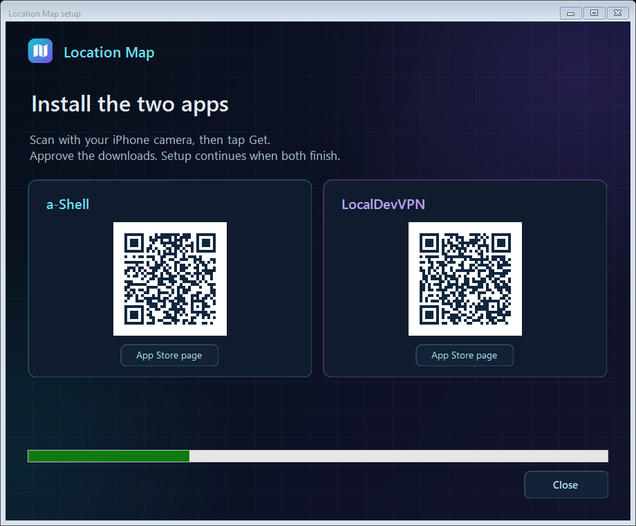

# Location Map

Set up Location Map on your iPhone using a Windows computer. The setup window walks you through each step.

**[Open the visual setup guide](https://angry512.github.io/location-map/)** · [Release files](https://github.com/Angry512/location-map/releases/tag/v0.1.0-preview)

## Start here

1. **Download** the ready-to-run Windows ZIP using the button above.
2. **Extract it:** right-click `Location-Map-Windows.zip`, choose **Extract All**, then **Extract**.
3. Open the extracted **Location Map** folder. Connect one iPhone, unlock it, and double-click **START HERE.cmd**.

Keep the phone connected and unlocked. The setup window waits while you approve the phone prompts. You can run the whole extracted folder from your computer or a USB drive.

### What you need

- A Windows 10/11 PC with an Intel or AMD 64-bit processor.
- An iPhone and a USB cable that can transfer data. The installer checks for iOS 26.4 through iOS 27.x.
- Internet access, room for the full a-Shell download, and the ability to approve prompts on the phone.

### The few phone steps

The setup window shows these as you need them:

- **Trust** the computer and enter the phone passcode on the phone.
- **Developer Mode:** Settings → Privacy & Security → Developer Mode. Turn it on, restart, unlock, and confirm **Turn On**.
- Download the full **a-Shell** and **LocalDevVPN** from the App Store using the codes in setup.
- In LocalDevVPN, choose **Connect**, approve the VPN configuration, and enter the phone passcode if asked.
- Import and run the **Location Map** shortcut, allow its requested access, and add its Home Screen icon.
- Keep both helpers installed. Hide their icons with **Remove App → Remove from Home Screen**. Do **not** choose **Delete App**.

The file transfer, integrity checks and fresh device pairing are automatic. The installer checks the first map launch and final Home Screen before reporting success.

### After setup

Open **Location Map** on the iPhone. Choose a point, tap **Simulate**, then use **Stop** to restore the real location. Check both operations on your phone. Keep a-Shell and LocalDevVPN installed.

There is no weekly sideload signing renewal because this setup uses App Store apps. Future iOS/helper updates or recovery can still require an updated setup. Away from Wi-Fi, let the launcher's brief cellular pause finish; if you cancel a launch, check Cellular Data is back on.

## Verification status

This is a **setup preview**, not a claim of universal compatibility. The packaged app, installer state machine, Windows starter and recovery checks passed on the computer. The complete fresh-iPhone install, unplugged cellular use and reboot flow for this exact release remain unverified.

- [Computer checks and their scope](Support/Docs/COMPUTER%20CHECKS.txt)
- [What setup automates and what still needs approval](Support/Docs/ABOUT%20THIS%20KIT.txt)
- [Full hardware release checklist](Support/Docs/Release-checklist.md)

No personal pairing file, phone location, account credential or owner-specific device ID is included. Each recipient gets fresh pairing during setup. Enter passwords and passcodes only in Apple's own prompts on the phone.

## Source and maintenance

The **release ZIP** contains everything a recipient needs. This repository contains the installer, signed launcher, application source archive, website and checks. The large Windows runtime is distributed as a release asset instead of being stored in Git. A GitHub source-code ZIP is for development; use **Download Windows setup** for the complete package.

- `Support/Installer/`: USB staging, pairing and guided setup backend.
- `Support/Setup.ps1`: the Windows setup window and runtime bootstrap.
- `Support/Phone/Location-Map-source.zip`: complete application source and notices.
- `Support/Sources/`: launcher/build/verification source.
- `tests/`: computer-only installer checks.
- `index.html`, `assets/`: the accessible static setup guide.
- `tools/build_release.py`: packages and verifies the ready-to-run release.

See [DEVELOPING.md](DEVELOPING.md) for repeatable build and verification instructions. The runtime carries Python and library license files. Apple developer-image files are fetched and checked during setup, rather than redistributed in the download.

## License and credits

Location Map's application license is [GPL-3.0](LICENSE); dependencies retain their own notices. It builds on the on-device developer-service approach used by [StikDebug](https://github.com/StikDebug/StikDebug), [pymobiledevice3](https://github.com/doronz88/pymobiledevice3), [a-Shell](https://github.com/holzschu/a-shell) and [LocalDevVPN](https://github.com/jkcoxson/LocalDevVPN). This project is not affiliated with Apple or those projects.
